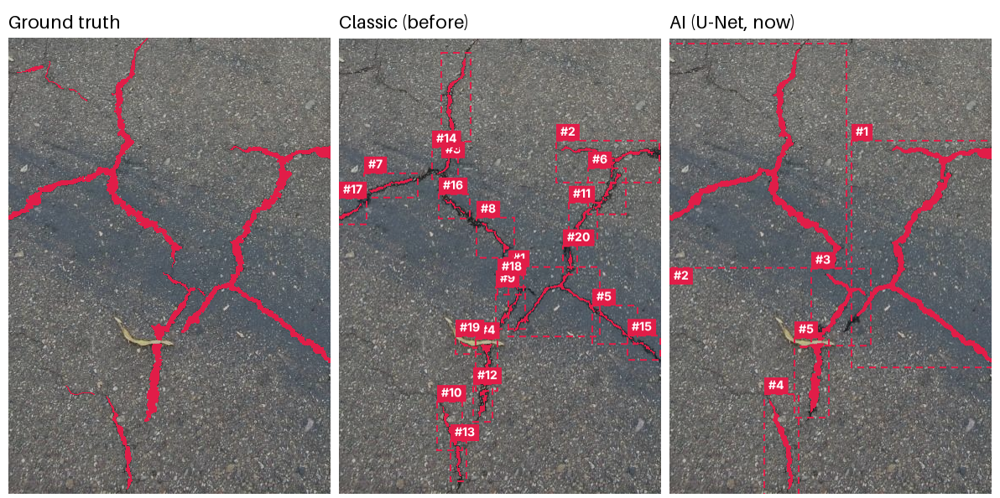

# 壁のひび割れ検出アプリ

家の外壁・内壁・基礎などの写真から、ひび割れを自動で検出して
長さ・幅の目安と危険度を表示する静的Webアプリです。
解析はすべてブラウザ内で行い、写真は外部に送信されません。

## 検出方式と精度

| 方式 | 適合率 | 再現率 | F1 |
|---|---|---|---|
| **AI(U-Net)** ※既定 | 0.954 | 0.892 | **0.922** |
| 画像処理 | 0.985 | 0.380 | 0.549 |

DeepCrack データセットのテスト画像237枚(学習には未使用)で、アプリと同じ後処理を含めて
画素単位(2px許容)で評価した値です。感度はどちらも既定値(50)。



AIモデルは [onnxruntime-web](https://onnxruntime.ai/)(CDNから読み込み)で端末内で実行します。
モデルを読み込めない環境(オフライン、`index.html` を直接開いた場合など)では自動で画像処理方式に切り替わります。
学習・評価の手順は [training/README.md](training/README.md) を参照してください。

## 使い方

```bash
cd crack-detector
python3 -m http.server 8000
```

`http://localhost:8000` を開き(AIモデルの読み込みにはローカルサーバーが必要です)、写真を選択(スマホではカメラで撮影も可)します。
「サンプル画像で試す」で合成画像による動作確認ができます。

1. 写真を選ぶと自動で検出し、ひびを色付きで表示します
2. 「写真の横幅に写っている実際の長さ(cm)」を入力すると、幅を mm で表示して判定します
3. 誤検出が多い/見逃しがある場合は「感度」「最小の長さ」「細長さの下限」を調整します
4. 「結果を保存」で検出結果を PNG で保存できます

## 判定基準(目安)

| 最大幅 | 判定 | 説明 |
|---|---|---|
| 0.3mm 未満 | ヘアクラック | 表面の乾燥収縮など。経過観察 |
| 0.3〜0.5mm | 要注意 | 雨水浸入の可能性。補修を検討 |
| 0.5mm 以上 | 要点検 | 構造クラックの可能性。専門家に相談 |

## 検出の仕組み

1. ひび候補の抽出
   - **AI方式**(`app.js`): 画像を最大1024pxに縮小し、512px のタイルに分けて U-Net で「ひびらしさ」を推定。
     確実な画素を起点に、やや弱い画素までつなげる(ヒステリシス二値化)
   - **画像処理方式**(`detector.js`): 局所平均との差分で「周囲より暗い部分」を抽出し、表面のざらつきを基準に二値化
2. クロージングで途切れをつなぐ
3. 連結成分ごとに大きさで足切り
4. Zhang-Suen 細線化で骨格を求めて長さを計測
5. 距離変換で骨格上の幅を計測
6. 「長さ ÷ 平均幅」が小さい塊(シミ・穴など)を除外

## 制限事項

- AIモデルの学習データ(DeepCrack)はコンクリート・アスファルトなどの路面・壁面写真が中心です。
  サイディングやタイルの目地、塗装の模様などは誤検出する可能性があります。
- DeepCrack は研究用に公開されたデータセットです(明示的なライセンス表記なし、利用時は論文の引用が求められています)。
  商用で配布する場合は、データの権利を確認するか自前のデータで学習し直してください。
- 結果はあくまで簡易的な目安であり、建物の安全性の判断は専門家の調査を受けてください。

## ファイル構成

- `index.html` - 画面
- `style.css` - スタイル(ダークモード・スマホ対応)
- `detector.js` - ひび割れ検出エンジン(候補抽出・計測、依存なし)
- `app.js` - 画像読み込み・AI推論・描画・結果表示
- `model/crack-unet.onnx` - 学習済みAIモデル
- `training/` - モデルの学習・評価スクリプト
